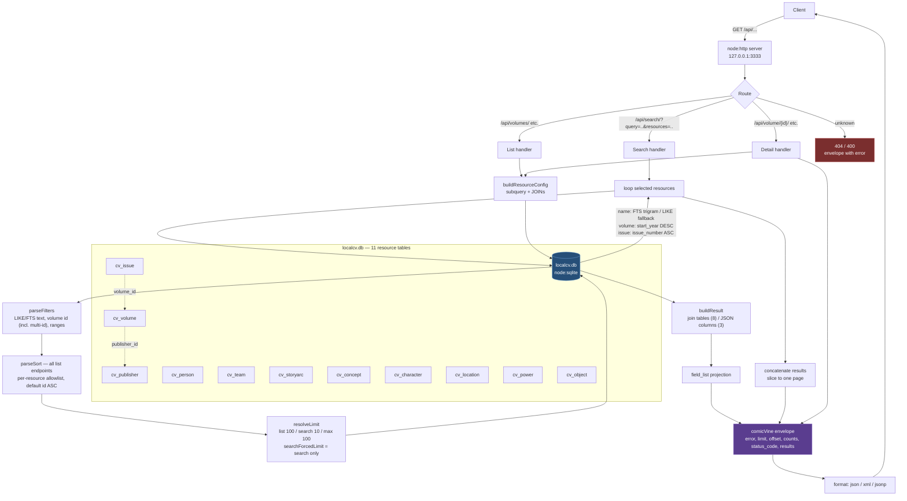
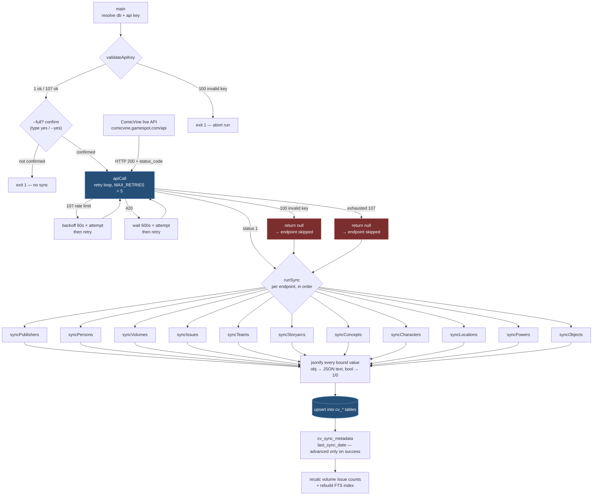
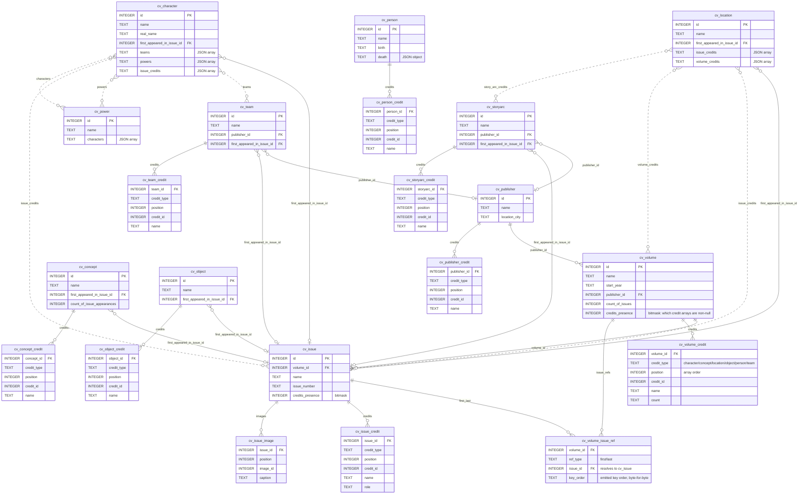

# ComicVine Local — Architecture

## Server request flow (`src/server.js`)

## Updater sync pipeline (`src/updater.js`)

The updater is a zero-dependency Node.js script (`node:sqlite` + `fetch`). Run it with `npm sync` (incremental) or `npm sync:full`.

## Database schema (`localcv.db`)

Solid edges are real columns; dotted edges are JSON-text relationship columns (parsed in JS, never joined in SQL). Not every column is shown — see the updater for the full column list.

Notes on the schema:

- `cv_sync_metadata` (endpoint, last_sync_date, last_sync_timestamp, resume_state) tracks updater progress per endpoint — not shown above.
- **Eight resource tables are normalized:** publisher, volume, issue, person, team, storyarc, concept, and object store their relationship collections in `cv_*_credit` join tables (plus `cv_volume_issue_ref` for a volume's first/last issue and `cv_issue_image` for an issue's images) rather than JSON columns. The legacy JSON columns were dropped by the one-shot migrations (v2, v7–v12). `credits_presence` (on `cv_volume` and `cv_issue`) is a bitmask the server uses to tell an empty `[]` from a `null` collection.
- **Three resource tables still store their relationships as JSON text** (the dotted edges): character, location, and power. Their normalization is a future SRV-6 item.
- **`cv_volume_issue_ref` is a true join to `cv_issue`:** it stores only the issue `id` (FK) and the emitted `key_order`; the server resolves `name`/`issue_number`/`api_detail_url` by joining `cv_issue`. Issues *do* have a local table, so the denormalized snapshot is not needed. A `LEFT JOIN` keeps a ref whose issue id isn't in the (synced-subset) `cv_issue` table, emitting the id with `null` display fields.
- The credit join tables keep `name`/`api_detail_url`/`site_detail_url` inline by design (the SRV-6 pattern): a `LEFT JOIN` to the referenced entity's local table would diverge if that row were re-synced after a rename, and the live API's denormalized values are the ground truth for byte-for-byte output. In the three still-JSON tables, referenced ids usually do **not** resolve to local rows (the DB is a synced subset), and `movie` has no local table at all — the denormalized fields inside the JSON are the only source of that data.
- **The served `localcv.db` is at the final schema** (brought up by `migrate()`; the `schema_version` stamp records the last applied migration). A fresh database gets the final schema directly from the idempotent `CREATE`s, except the four legacy tables (`cv_publisher`, `cv_volume`, `cv_issue`, `cv_person`) are Python-updater heritage and are not created by `migrate.js` — they exist only in databases the updater built.
- The FTS5 full-text indexes (`cv_*_fts`), `comicdb_*.db` (raw dumps), and dated `localcv-*.db` snapshots are out of scope for the API and excluded from the diagram above. `comicvine_rawapi_*.db` (the verbatim-JSON ground-truth snapshot, RAW-1) is likewise out of scope: it is maintained by the rawapi process ([src/rawapi.js](../src/rawapi.js)) and is never read by the server.

## Notes

- **Server** is a single file, zero npm deps: `node:http` + `node:sqlite`. Every **list** endpoint honors `?sort=` (SRV-1); only `search` honors `COMICVINE_FORCED_LIMIT`.
- **Search** matches each selected resource on its `name` column: an FTS5 trigram `MATCH` when the resource's `cv_*_fts` index is populated (gated on the FTS `_data` shadow table, SRV-32; queries ≥ 3 chars), else a case-insensitive `LIKE` (SRV-5). Volumes come newest-first, issues by numeric issue number; the hits are concatenated in resource order and sliced to one page, so `number_of_total_results` is the combined count across resources.
- **Updater** is incremental by default (`date_last_updated` filter since last safe sync date); `--full` drops the filter but is gated behind a `yes` confirmation (UPD-2). `validateApiKey` runs once at startup — a `100` there aborts the whole run (`exit 1`); a `100`/exhausted-`107` *mid-run* just makes `apiCall` return `null` and that endpoint is skipped. Skipped endpoints don't advance `cv_sync_metadata`, so the next run re-syncs from the old start date.
- **Rawapi** (RAW-1) is a third process ([src/rawapi.js](../src/rawapi.js)) that keeps `comicvine_rawapi_*.db` in step with the live API: for every entity changed since the last sync it stores the **verbatim** `results` JSON in the uniform `cv_*` tables (`id`, `date_last_updated`, `site_detail_url`, `raw_api_response`). Resources sync smallest-first so `cv_issue` is always last; a list call that still fails after retries skips that table and the sync continues. It updates the database in place (no dated-copy mechanism) and reuses the updater's `cv_sync_metadata` resume tracking.
- The three still-JSON tables (character, location, power) store their relationship collections as JSON text; the server parses them in JS, never in SQL. The other eight tables' relationships live in join tables and are resolved in SQL.
