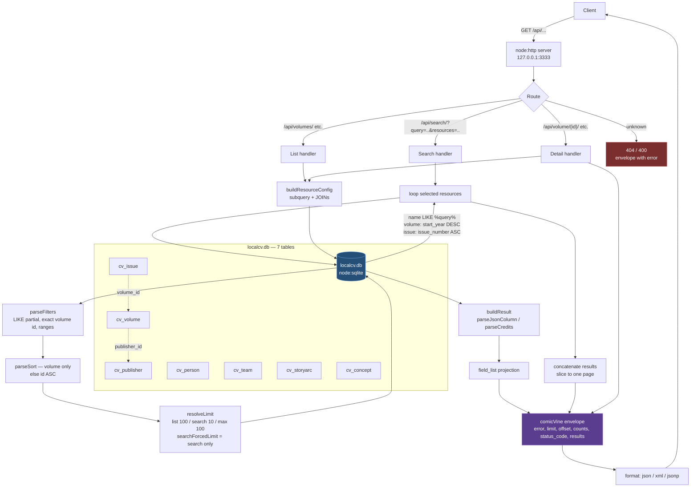
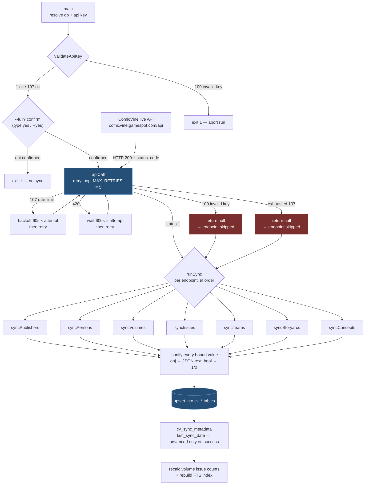
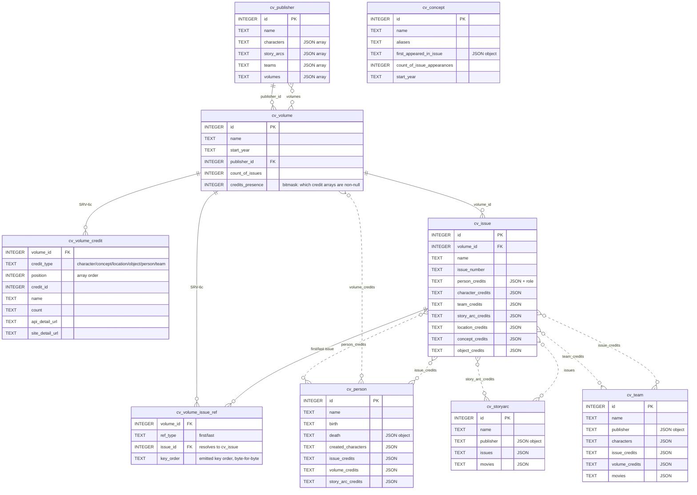

# ComicVine Local — Architecture

## Server request flow (`src/server.js`)

## Updater sync pipeline (`src/updater.js`)

The updater is a zero-dependency Node.js script (`node:sqlite` + `fetch`). Run it with `npm sync` (incremental) or `npm sync:full`.

## Database schema (`localcv.db`)

Solid edges are real columns; dotted edges are JSON-text relationship columns (parsed in JS, never joined in SQL). Not every column is shown — see the updater for the full column list.

Notes on the schema:

- `cv_sync_metadata` (endpoint, last_sync_date, last_sync_timestamp, resume_state) tracks updater progress per endpoint — not shown above.
- **`cv_volume` is normalized (SRV-6c):** its credit collections and first/last issue references live in the `cv_volume_credit` / `cv_volume_issue_ref` join tables, not JSON columns (the JSON columns are dropped by the updater backfill). `credits_presence` is a bitmask the server uses to tell an empty `[]` from a `null` collection. The other tables still store their relationships as JSON text (dotted edges) and are staged for the same treatment (SRV-6a/b/d/e/f).
- **`cv_volume_issue_ref` is a true join to `cv_issue`:** it stores only the issue `id` (FK) and the emitted `key_order`; the server resolves `name`/`issue_number`/`api_detail_url` by joining `cv_issue`. Unlike the credit entities (no local table), issues *do* have a local table, so the denormalized snapshot is not needed. A `LEFT JOIN` keeps a ref whose issue id isn't in the (synced-subset) `cv_issue` table, emitting the id with `null` display fields.
- Referenced ids inside JSON collections usually do **not** resolve to local rows (the DB is a synced subset), and character/location/object/movie have no local table at all — the denormalized fields inside the JSON are the only source of that data. In `cv_volume_credit` the credit rows likewise keep `name`/`api_detail_url`/`site_detail_url` inline for the same reason.
- `comicdb_*.db` (raw dumps), dated `localcv-*.db` snapshots, and the FTS tables (`volume_fts*`, `comic_covers`, `comic_files`) are out of scope for the API and excluded here.

## Notes

- **Server** is a single file, zero npm deps: `node:http` + `node:sqlite`. Every **list** endpoint honors `?sort=` (SRV-1); only `search` honors `COMICVINE_FORCED_LIMIT`.
- **Search** matches `name LIKE %query%` per selected resource (volumes newest-first, issues by numeric issue number), concatenates the hits in resource order, then slices one page — so `number_of_total_results` is the combined count across resources.
- **Updater** is incremental by default (`date_last_updated` filter since last safe sync date); `--full` drops the filter but is gated behind a `yes` confirmation (UPD-2). `validateApiKey` runs once at startup — a `100` there aborts the whole run (`exit 1`); a `100`/exhausted-`107` *mid-run* just makes `apiCall` return `null` and that endpoint is skipped. Skipped endpoints don't advance `cv_sync_metadata`, so the next run re-syncs from the old start date.
- Credit/relationship columns are JSON text; the server parses them in JS, never in SQL.
